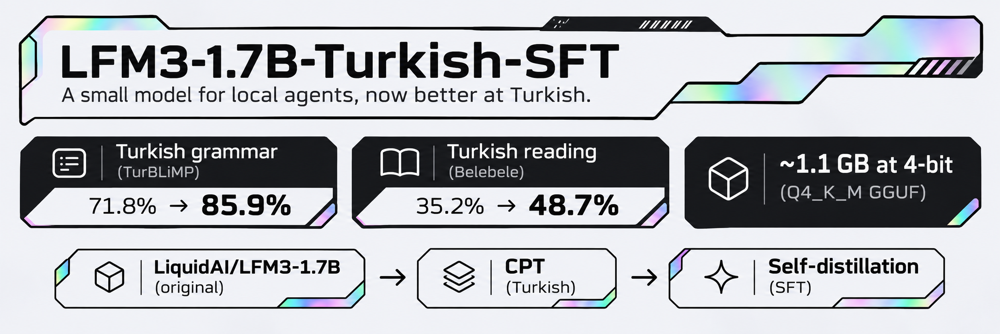
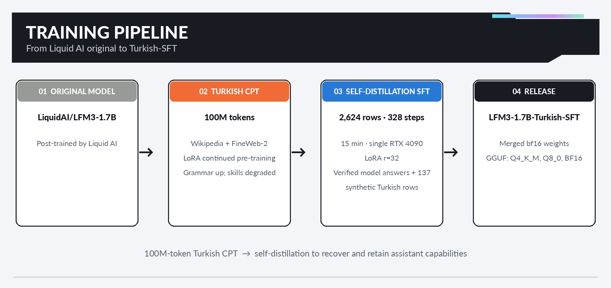
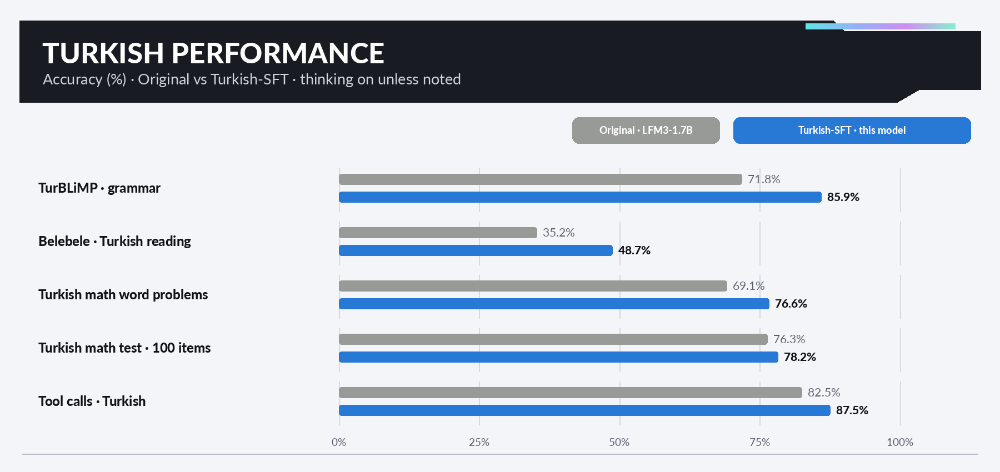
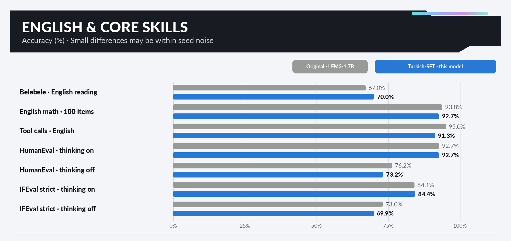
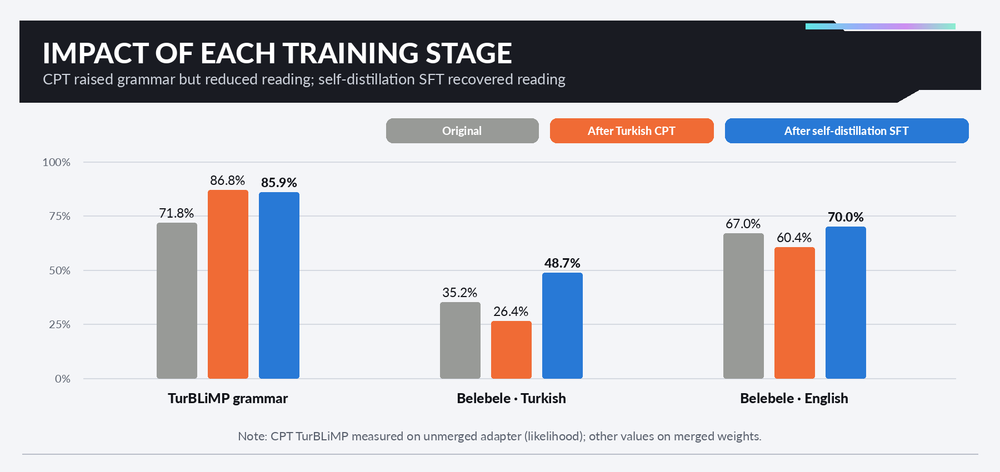

# LFM3-1.7B-Turkish-SFT

A Turkish-improved version of [`LiquidAI/LFM3-1.7B`](https://huggingface.co/LiquidAI/LFM3-1.7B), a **small text model for local agents**.
It reads and writes Turkish better than the original while keeping English, math, coding, tool calling and instruction following close
to the original.

- **Self-distillation:** the Turkish skills were added by fine-tuning on the model's *own* verified answers, so its English, tool-calling
  and reasoning behaviour is preserved instead of overwritten.
- **Turkish gains:** TurBLiMP grammar 71.8% to **85.9%**, Belebele Turkish reading 35.2% to **48.7%**, Turkish math word problems
  69.1% to **76.6%**.
- **Same footprint:** 1.7B parameters, about 1.1 GB at 4-bit (Q4_K_M GGUF included).

**Status: first release, modest absolute Turkish quality.** The model still invents words and gets facts wrong in free Turkish writing
(see Limitations). It is a better starting point for Turkish than the original model, not a finished Turkish assistant.



## Model details

| Property | Specification |
|---|---|
| Base checkpoint | [`LiquidAI/LFM3-1.7B`](https://huggingface.co/LiquidAI/LFM3-1.7B) (post-trained, text-only; not `LFM3-1.7B-Base`) |
| Parameters | 1.73B |
| Architecture | 24 layers: 13 gated short convolutions, 5 sliding-window attention, 6 global attention (unchanged) |
| Languages | Turkish and English (the original model's other languages were not evaluated) |
| Training | Turkish continued pre-training, then self-distillation SFT (both LoRA, merged) |
| Weights | merged, bfloat16 |
| Context length | 256K tokens in the original model. Fine-tuned on sequences up to 8,192 tokens, longer contexts were not tested. |
| License | [LFM Open License v1.0](https://huggingface.co/LiquidAI/LFM3-1.7B/blob/main/LICENSE), same as the original model |

Like the original, it is meant for local agents, tool calling, structured outputs and further fine-tuning. It is not recommended for
agentic coding or complex multi-step reasoning because of its size. Use retrieval or search for knowledge-heavy tasks.

## Inference

The model keeps the original chat template. Thinking is on by default. Pass `enable_thinking=False` to the template to turn it off.
It uses custom code, so `trust_remote_code=True` is needed. Thinking mode reasons in English, also for Turkish questions.

```python
from transformers import AutoModelForCausalLM, AutoTokenizer
repo = "cbarkinozer/LFM3-1.7B-Turkish-SFT"
tok = AutoTokenizer.from_pretrained(repo)
model = AutoModelForCausalLM.from_pretrained(repo, trust_remote_code=True, dtype="bfloat16", device_map="auto")
msgs = [{"role": "user", "content": "Mevsimler neden oluşur? Kısaca açıkla."}]
inputs = tok.apply_chat_template(msgs, add_generation_prompt=True, return_tensors="pt", return_dict=True,
                                 enable_thinking=False).to(model.device)
out = model.generate(**inputs, max_new_tokens=400, do_sample=True, temperature=0.1, top_k=50, repetition_penalty=1.1)
print(tok.decode(out[0][inputs["input_ids"].shape[1]:], skip_special_tokens=True))
```

Recommended sampling for general text: temperature 0.1, top_k 50, repetition penalty 1.1 (the original model card's settings).
For math, temperature 1.0, top_p 0.95, top_k 20 was used in the evaluation.

### GGUF files (llama.cpp)

| File | Size | Notes |
|---|---|---|
| `LFM3-1.7B-Turkish-SFT-Q4_K_M.gguf` | 1.1 GB | smallest, good default |
| `LFM3-1.7B-Turkish-SFT-Q8_0.gguf` | 1.85 GB | close to lossless |

Other formats (for example a lossless BF16 GGUF or other quantizations) can be made from the safetensors weights in this repository with
llama.cpp's `convert_hf_to_gguf.py` and `llama-quantize`. Use a llama.cpp build with LFM3 support (b12088 or newer). The model is text-only, so there is no `mmproj` file. All numbers below were
measured on the unquantized weights. The quantized files were only checked with short generations.

## Performance

Same prompts, sampler and checkers for the original model and this model, thinking on unless noted. All scores are **percentages of
correct answers, higher is better**, except the two writing-probe rows, which are marked. One training run per recipe. Two identical
trainings with different seeds differed by up to 7 percentage points on Turkish math, so **differences of a few points are noise**.





| Benchmark | LFM3-1.7B (original) | This model |
|---|---|---|
| **Turkish** | | |
| TurBLiMP grammar, 1,600 sentence pairs (likelihood, thinking off) | 71.8% | **85.9%** |
| Belebele Turkish reading, 900 questions (answer-letter likelihood, thinking off; chance is 25%) | 35.2% | **48.7%** |
| Turkish math word problems, 152 items x 4 seeds | 69.1% | **76.6%** |
| Turkish grade-school math, 100 test items x 4 samples | 76.3% | 78.2% |
| Tool calls, Turkish (80 items) | 82.5% | 87.5% |
| Writing probe, naturalness, AI rating from 1 to 5 (higher is better), 40 prompts, thinking off | 2.43 | **3.10** |
| Writing probe, invented or wrong words per answer (**lower is better**), same AI rating | 3.27 | **1.45** |
| Writing probe, task correctness (yes = 1, partly = 0.5, no = 0), same AI rating | 0.34 | 0.39 (no clear gain) |
| **English and skills** | | |
| Belebele English | 67.0% | 70.0% |
| English grade-school math, 100 test items x 4 samples | 93.8% | 92.7% |
| Tool calls, English (80 items) | 95.0% | 91.3% |
| HumanEval code, thinking on | 92.7% | 92.7% |
| HumanEval code, thinking off | 76.2% | 73.2% |
| IFEval instruction following, strict, thinking on (270 prompts) | 84.1% | 84.4% |
| IFEval instruction following, strict, thinking off (541 prompts) | 73.0% | 69.9% |

How to read it: Turkish grammar (TurBLiMP) and reading (Belebele) improved clearly. Free Turkish writing became smoother with fewer invented words, but not more correct. Math, code and instruction following stayed within a
few percentage points of the original. Two small drops are worth knowing: tool calls in English (-3.8 points) and IFEval without
thinking (-3.1 points).

## Examples

These five prompts were **drawn at random** from the 40 writing-probe prompts (fixed seed 3407), not picked for how they look.
Thinking off, one sample each, same prompt and sampler for both models (temperature 0.1, top_k 50, repetition penalty 1.1). Only leading
and trailing whitespace is removed. They are the actual saved outputs, in full.

How the whole probe came out, by the AI rating (40 prompts): this model is **more natural on 25 prompts, the original on 5, and 10 are
tied**. For doing what the prompt asks (task correctness) the two are about even: this model is better on 11 prompts, the original on 8,
and 21 are tied. So the Turkish is smoother and has fewer invented words, but free writing is **not more correct**. The random draw
below shows that mix.

### 1. Explain: why do clouds produce rain?

Source item: `wr-tr-04`.

**Prompt**

> Bulutlar neden yağmur yağdırır? Kısa ve anlaşılır bir açıklama yaz.

**LFM3-1.7B (original)**

<details>
<summary>Read the full response of the original model: garbled</summary>

````text
**Bulutlar yağmur yağdırıyor mısınız?**  
Kısa ve anlaşılır bir şekilde:

- **Sıcaklık ve nem:** Bulutlar, havanın sıcaklığını ve nemini taşıyabilir. Eğer bulutlar yüksekliğinde sıcaklık düşerse (örneğin 10°C'den 0°C'ye), su buharlaşma ve çökme sürecine girer.  
- **Su buharı ve karışım:** Sıvı bulutlar içinde birleşir; bu karışım (bulutun içindeki su buharları) hava içinde düşmeye başlar.  
- **Düşme ve yoğunlaşma:** Bulutlar, yüzeyde rüzgar veya dalgalar tarafından sürülerek yükselir. Yüksekte serinleyip su buharları kararsa, su birbirine bağlanır (kondensasyon). Bu su çöpleri (gölgelik kütleler) üzerinde küçük bulut parçacıkları oluşturur.  
- **Yağmur oluşumu:** Parçacıklar birbirleriyle tozla ve su ile birleşir. Ağır bir bulut oluşursa, bu suyu havaya düşürür. Havanın sıcaklığı 0°C'nin altına düşerse, su buharı çökerek yağış (yağmur, kar, gök gürültülü yağış vb.) olur.

**Özet:** Bulutlar, havada su buharlarını taşırken, yükselen ve serinlenirken bu bulutlar birleşir. Düştüğünda bu su birleşimiyle yağmur oluşturur. Yani **sıcak, nemli ve yükselen bulutlar → yağmur**. 🌧️
````

</details>

**This model**

<details>
<summary>Read the full response of this model: readable but wrong</summary>

````text
Bulutlar, havanın sıcaklığını yükseltir ve bu sıcaklık, su buharı hâline dönüşür. Bu su buharı, yüksekliğe doğru yükselirken soğuklaşarak, küçük bulutlara dönüşür. Bulutların büyümesi ve yoğunlaşması, yağışın oluşmasını sağlar. Yani bulutlar, havayı sıcaklıkla donatırır ve bu sıcaklık su buharını hâle getirerek yağmur yaparlar.

Kısaca: **Bulutlar, havayı sıcaklıkla donatır; sıcaklık su buharını hâle getirir; bu su buharı yükselirken soğur ve bulutlar büyür; büyümüş bulutlar yağışa dönüşür.**
````

</details>

The original answer is garbled ("yağdırıyor mısınız?", "su çöpleri"). This model is shorter and more readable, but the physics is wrong (it says clouds raise the temperature, and it skips how droplets grow until they fall).

### 2. Polite email to a landlord about a broken boiler

Source item: `wr-tr-09`.

**Prompt**

> Kiracı olduğun evdeki kombi bozuldu. Ev sahibine durumu bildiren, kibar ama net bir e-posta yaz.

**LFM3-1.7B (original)**

<details>
<summary>Read the full response of the original model: incoherent email</summary>

````text
**Konulma:** Kombi bozulmuş, içeriği kaybedilmiş veya dış yüzeyi hasar görmüş.

**Alan:** Ev sahibimde (evin giriş kapısı / kapalı odak) şu an bir kombi var ama iç kısm (sadece kapak ve dış yüzey) bozulmuş. İçerik (çadır, cüzdan, malzemeler vb.) kaybolmuş ya da eriyip boş kalıyordur. Kapak ise hâlâ düzgün ama iç boşluk var.

**Acil Durum:** Yazılım/teknik bir sorun olabilir; kombi otomobil üreticisiyle iletişime geçmek iyi olur.

---

**E-Posta:**

**Konu:** Kombi Bozulma Raporu – [Ev Adı] – 2024-10-26

**Merhaba,

Yatırım ettikten sonra alınan **[Kombi Model/Şirket Adı]** kombi, **[Tarih]** tarihli bir incident sonucu **bozulmuş**. İşte detaylar:

1. **Bozulma Alanı:**  
   - **Kapak/Boru:** Dış yüzey hasarı (kırılma, çatlak).  
   - **İç Mekan:** Kapak açarak içerecek kapı/çatı bozulmuş, iç kaplama (sadece kapak) hâlâ okuduğu gibi görünüyor.  
   - **İçerik Kaybı:** Çadır, cüzdan, spor ekipmanları, elektronik cihazlar (telefon, laptop) içeriği içinde kayıp/gazlanmış.

2. **Neden?**  
   - Otomotiv üreticiyle iletişime geçmiş bir rapor (veya raporunuzun belirtisi) göre: **[Örn: Motor/Çamur hasarı, iç mekan sıcaklık anomali, veya fabrikal bir bozulma]**.

3. **Şu An Durum:**  
   - Kombi **kapalı** ama **içerik boş** veya **hasar görmüş**.  
   - Sadece dış kapak/çatı sorun değil, iç mekan da etkili.

4. **Hazırlık İhtiyacı:**  
   - **Teknik Kontrol:** Kullanıcının içeriğini geri alması için otomobil üreticinizin teknik servis/dikkatli teslimat planını kontrol etmeniz gerekebilir.  
   - **Güvenlik:** Kayıp malzemeleri (cüzdan, dokümantasyon) geri alınmasını talep edebilirsiniz.

5. **Sonraki Adımlar:**  
   - Otomobil üreticinize **imzalı bir rapor** ile bildirin.  
   - Gerçek zamanlı takım/geri alma imkanı sağlayacak bir **takım (tracking)** numarasına dikkat edin.  
   - Eğer bu bir **kombi kiralama** ise, kiralatıcıdan da durumu bildirin.

**Lütfen:**  
- Kombi modelini ve kiralama/takım tarihi bilgilerini paylaşın.  
- Hangi üretici/marketa satıldı?  
- Başka bir sorun varsa (örneğin, takım gecikmesi) bildirin.

Daha net bir çözüm için hızlı bir telefon/chat ile üreticiye iletişime geçmeyi tavsiye ederim.

Huzurla,
[Ben Imajınız] — AI Asistanı

---
````

</details>

**This model**

<details>
<summary>Read the full response of this model: two unhelpful sentences</summary>

````text
Kombinin bozulması için bir sorun var. Sorununuzu bana iletebilir mi? Eğer sorunu çözmek için bir şey yapmanız gerekiyor ise o zaman size yardımcı olabilirim.
````

</details>

Both fail. The original writes a long, incoherent email about a "car manufacturer". This model writes two unhelpful sentences that reverse the roles.

### 3. Email to a lecturer asking for a one-day extension

Source item: `wr-tr-14`.

**Prompt**

> Üniversitedeki hocana, ödev teslim tarihini bir gün uzatmasını rica eden bir e-posta yaz. Hastalandığını belirt.

**LFM3-1.7B (original)**

<details>
<summary>Read the full response of the original model: invented words</summary>

````text
**Konu:** Ödev Teslim Tarihini Bir Gün Uzatmak İsteyim

**E-posta:**

Dünyaya Hoşgunlar,

Lütfen bana bir gün uzatmanız gerektiğini belirtmek istiyorum.

Hastalıktan dolayı bugün ödev teslimini yapamıyorum. Lütfen lütfen bu tarihini [tarih]'ye itertekçe onaylayın veya bana yeni bir tarih önerin.

Cevap, bana bir mesaj gönderdiğinde alırım.

İyi günler!

Hesabangı
[Adınız]
[Telefon numarası (isteğe bağlı)]
````

</details>

**This model**

<details>
<summary>Read the full response of this model: fluent but not a valid request</summary>

````text
E-Posta

Konu: Ödev Teslim Tarihi Uzatma Rızası

Merhaba,

Ödevimi 15 Nisan 2024 tarihinde teslim etmeyi planlıyorum. Ancak hastalıktan dolayı bu tarihin sonuna kadar gecikebilirim. Bu yüzden ödevimi 16 Nisan 2024 tarihine ertelerim.

Teslimi 16 Nisan 2024 tarihinde yapabilir misiniz? Eğer mümkün değilse en geç 17 Nisan 2024 tarihine geri gönderirim.

İyi çalışmalar dilerim.

Saygılarımla,
[Adınız]
````

</details>

The original has invented words ("Hoşgunlar", "itertekçe"). This model reads like an email, but it is not a valid request: it invents dates, says the student will postpone the submission instead of asking, asks the lecturer whether the student may submit, and adds a second date (17 April) although one day was requested.

### 4. Shorten a formal sentence (mixed)

Source item: `wr-tr-22`.

**Prompt**

> Şu cümleyi sade ve kısa hale getir: "Tarafımızca gerçekleştirilen değerlendirme neticesinde söz konusu başvurunun kabul edilmesine karar verilmiştir."

**LFM3-1.7B (original)**

<details>
<summary>Read the full response of the original model: keeps the tone, barely simpler</summary>

````text
**Sade ve kısa bir versiyon:**  
"Değerlendirme sonucu başvurunun kabul edilmesi kararı verilmiştir."
````

</details>

**This model**

<details>
<summary>Read the full response of this model: shorter, shifts tense and perspective</summary>

````text
Tarafımızca yapılan değerlendirmenin sonucunda, başvurunuz kabul edilir.
````

</details>

The original keeps the completed, impersonal decision but barely simplifies the sentence. This model is shorter and simpler, as asked, but shifts to the present tense and addresses the applicant, so it loses some nuance. Both say the application is accepted.

### 5. Short poem about a ferry ride in Istanbul (a tie)

Source item: `wr-tr-27`.

**Prompt**

> İstanbul'da vapurla yapılan bir yolculuğu anlatan kısa bir şiir yaz.

**LFM3-1.7B (original)**

<details>
<summary>Read the full response of the original model</summary>

````text
**Vapur Yolculukları**

Güneşin altından bir ışık,
Buzlu suya yürürüm, İstanbul'a.

Köprülerin sesleri, akşamüstü,
Yelkenin dalgalarıyla bir ritim çizer.

Dünya bir kenara bırakır,
Vapurdan yollanan bu yol,
Sabahın ilk ışığında,
Uçurum, kalbime götürüyorum.

Suunun içinde zaman durur,
Tarihler ve seferler birleşir.
Bir kaderin, bir denizde,
Yolculuklar için bir şarkı.

Vapurla gitmek, bir sürpriz,
Rüzgarla birlikte, gökyüzüyle.
İstanbul'un kalbi, suya akar,
Ve ben de bu yolculuğumda kalbimi açar.
````

</details>

**This model**

<details>
<summary>Read the full response of this model</summary>

````text
Vapurın sesi, denizin derinliğinde,
Gölge gizlenir, ışık yansır.
Kumlar arasında, rüzgarın çarpar,
Yolculuk, bir hikâye gibi başlar.

Denizde, karanlıkta, gizli,
Birden bir ışık parlamış,
Bütün yürekler, birbirine bakıyor,
Dünyanın en büyük denizi.

Sabahın ilk ışıklarıyla,
Güneş, denizin üstünde,
Yolculuk, bir yolculuk gibi,
Hikayeyi, denize yazdırmış.

Vapur, denizde, bir kara gibi,
Gökyüzünün altına düşmüş,
Yolculuk, bir hikâye gibi,
Gözlerin, denizde gizlenmiş.

Vapurla, İstanbul'un denizinde,
Rüzgârın, denizde şenli,
Yolculuk, bir hikâye gibi,
Gözlerin, denizde gizlenmiş.
````

</details>

Both poems are weak: each has ungrammatical lines, repetition and incoherent images. The AI rating slightly preferred the original, and this is a matter of taste, so treat it as a tie.

## Training

The recipe has two stages on top of `LiquidAI/LFM3-1.7B`. Both train LoRA adapters that were merged into the weights.



| Stage | TurBLiMP grammar | Belebele Turkish | Belebele English | What happened |
|---|---|---|---|---|
| LFM3-1.7B (original) | 71.8% | 35.2% | 67.0% | starting point |
| + Turkish continued pre-training | 86.8% | 26.4% | 60.4% | grammar +15 points, but reading and assistant behaviour got worse: only 136 of 500 test generations ended normally |
| + self-distillation SFT (**this model**) | 85.9% | **48.7%** | **70.0%** | grammar kept, reading +22 points over the CPT stage, English back above the original |

### Stage 1: Turkish continued pre-training (CPT)

LoRA adapter trained on 100M tokens of raw Turkish text (Wikipedia and FineWeb-2) with the ordinary language-modelling loss. Released
separately as [`cbarkinozer/LFM3-1.7B-Turkish-CPT`](https://huggingface.co/cbarkinozer/LFM3-1.7B-Turkish-CPT) (revision `6f213ec2`, merged
into the weights before stage 2). It taught grammar but degraded instruction following and reading, which is why a second stage is needed.

### Stage 2: self-distillation SFT

Training data: [`cbarkinozer/LFM3-1.7B-Turkish-SFT-Dataset`](https://huggingface.co/datasets/cbarkinozer/LFM3-1.7B-Turkish-SFT-Dataset) (2,624 rows).

Instead of writing Turkish answers by hand or copying a larger model, the original `LFM3-1.7B` **answered the training prompts itself**.
Only answers that passed an automatic check were kept, and the model was then fine-tuned on them. This keeps the style and skills it
already had and repairs the damage from stage 1.

1. **Prompts:** English and Turkish math, code, tool calls, general English instructions and native Turkish tasks (sources below).
   Turkish math prompts are machine translations of English problems.
2. **Sampling:** several answers per prompt, with thinking on and off. For Turkish prompts the model reasons on the Turkish prompt itself.
3. **Verification:** math answers must reach the gold number, code must pass its unit tests, tool calls must match the schema, instruction
   prompts must satisfy their countable constraints. Turkish answers that came back in English or contained invented words were dropped.
   A prompt without a verified answer was dropped, never filled with a substitute.
4. **Selection:** a random verified answer per prompt, with no length cut, so the model does not learn to think shorter.
5. **Synthetic Turkish rows:** 137 rows were written or corrected by a language model (57 corrected answers to native Turkish tasks,
   80 polite emails). They are synthetic and **not reviewed by a human**.

| Setting | Value |
|---|---|
| Rows | 2,624 (2,045 thinking on, 579 thinking off) |
| Tokens | 2.98M, of which 2.72M are trained on (the answers) |
| Method | LoRA r=32, alpha=64, learning rate 1e-4, one epoch, 328 steps, max length 8,192, seed 3407 |
| Hardware and time | one RTX 4090, about 15 minutes |
| Final training loss (mean) | 0.47 |

| Part of the data | Rows | Origin of the answer | Prompt source |
|---|---|---|---|
| Math, English and Turkish | 1,648 | self-distilled | [GSM8K](https://huggingface.co/datasets/openai/gsm8k) train (MIT), Turkish machine-translated |
| English general instructions | 299 | self-distilled | [Dolly 15k](https://huggingface.co/datasets/databricks/databricks-dolly-15k) (CC BY-SA 3.0) |
| Code | 248 | self-distilled, unit tests passed | [MBPP](https://huggingface.co/datasets/google-research-datasets/mbpp) (CC BY 4.0) |
| Tool calls | 292 | self-distilled, schema checked | [Glaive function calling v2](https://huggingface.co/datasets/glaiveai/glaive-function-calling-v2) (Apache 2.0) |
| Turkish general tasks | 57 | synthetic, corrected | [Turkce-Atlas-Instruct](https://huggingface.co/datasets/AlicanKiraz0/Turkce-Atlas-Instruct) (MIT) |
| Turkish emails | 80 | synthetic | written for this release |

What the experiments showed along the way:
- Dropping the raw native Turkish task rows without a replacement made Turkish reading worse (Belebele Turkish 39.2% against 48.7%),
  so the reviewed replacement rows are in the data.
- Two identical trainings with different seeds differ by up to 7 percentage points on Turkish math. Treat small gaps as noise.

## Files in this repository

| Path | What it is |
|---|---|
| `model.safetensors` and the config, tokenizer and custom code files | the merged model (bfloat16), load with `transformers` |
| `LFM3-1.7B-Turkish-SFT-Q4_K_M.gguf`, `...-Q8_0.gguf` | GGUF files for llama.cpp |
| `adapter/` | the stage-2 LoRA adapter (applies on the CPT parent, see its README) |

Related: [training dataset](https://huggingface.co/datasets/cbarkinozer/LFM3-1.7B-Turkish-SFT-Dataset) and the
[Turkish CPT adapter](https://huggingface.co/cbarkinozer/LFM3-1.7B-Turkish-CPT).

## Limitations

- **Turkish free writing is still weak.** Invented words, wrong facts and unfinished or run-on answers are common. Do not rely on it
  for factual Turkish text without checking.
- **The writing rating is an AI rating**, from one rater, not a native speaker. This model writes shorter answers than the original model
  (about 101 against 139 words), which may account for part of the gain.
- **Turkish prompts are machine-translated.** The 100-item Turkish final test was translated and checked only by an AI.
- **Thinking mode reasons in English**, also for Turkish questions.
- **One run per recipe.** The development sets (152 diagnostic items, Belebele) influenced earlier decisions. The 100-item final
  test is the cleaner check and resolves about 8 to 10 points.
- The email rows cover one style and were written by an AI.
- Not tested for safety or bias beyond the original model.

## Acknowledgements

- **LiquidAI** for the `LFM3-1.7B` model this work builds on. This is an independent fine-tune, not an official release.
- **Training prompts:** Türkçe Atlas by **Alican Kiraz** (MIT), GSM8K (Cobbe et al., 2021, MIT), MBPP (Austin et al., 2021, CC BY 4.0),
  Glaive function calling v2 by **Glaive AI** (Apache 2.0) and databricks-dolly-15k by **Databricks, Inc.** (CC BY-SA 3.0). Details and
  license notes are in the [dataset card](https://huggingface.co/datasets/cbarkinozer/LFM3-1.7B-Turkish-SFT-Dataset).
- **Continued pre-training text:** Turkish Wikipedia and FineWeb-2 (see the [CPT adapter card](https://huggingface.co/cbarkinozer/LFM3-1.7B-Turkish-CPT)).
- **Evaluation:** [TurBLiMP](https://huggingface.co/datasets/juletxara/turblimp) (see its card for authors), Belebele (Bandarkar et al., 2023),
  GSM8K (Cobbe et al., 2021), HumanEval (Chen et al., 2021), IFEval (Zhou et al., 2023).

## License and modifications

This model is a Derivative Work of [`LiquidAI/LFM3-1.7B`](https://huggingface.co/LiquidAI/LFM3-1.7B) and is distributed under the same
**LFM Open License v1.0**. A copy of the license is in the [`LICENSE`](LICENSE) file of this repository. In short, use, modification and
redistribution are allowed under the conditions of the license, and **commercial use is licensed only for organizations whose annual
revenue is below US$10 million** (Section 5 of the license). Read the license before use. This is an independent fine-tune. It is not
affiliated with or endorsed by Liquid AI.

**Modified files** (Section 4(b) of the license):
- `model.safetensors` holds fine-tuned weights: the original model plus the merged Turkish continued-pre-training adapter and the
  self-distillation SFT adapter (see Training).
- The configuration, generation config, tokenizer and chat-template files have the same content as the original. They were re-saved
  with a newer `transformers` version, so version fields, default keys and line endings differ.
- `configuration_lfm3.py`, `lfm3_conv.py` and `modeling_lfm3.py` are unchanged copies of the original code files.
- `adapter/` and the GGUF files are new.
